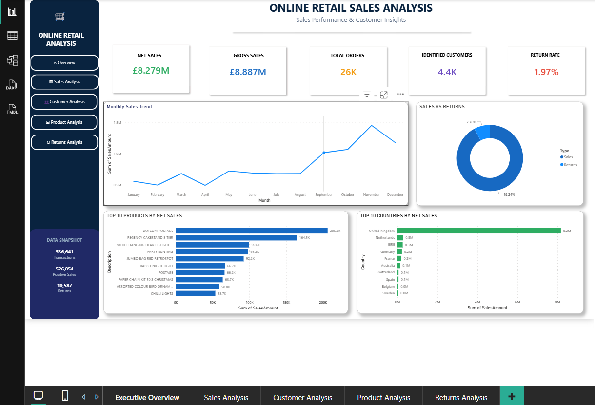
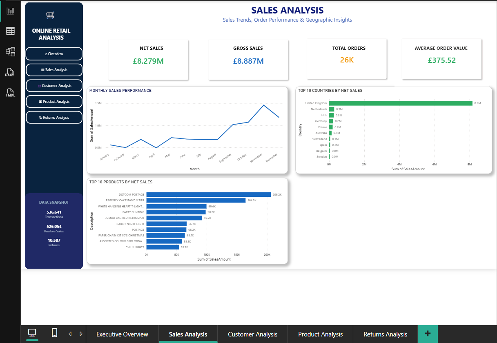
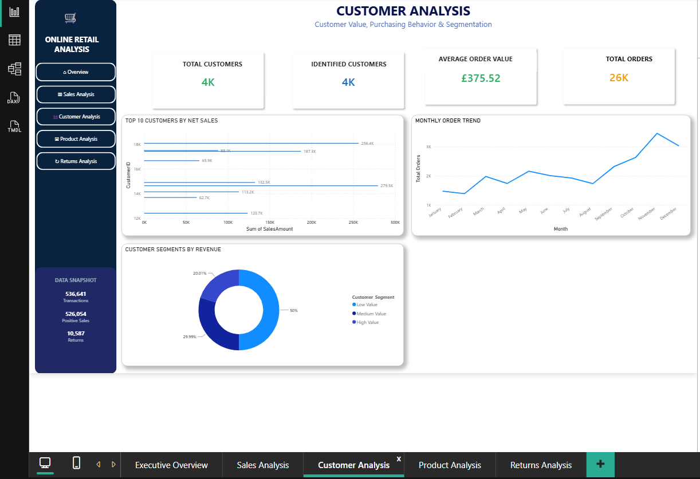
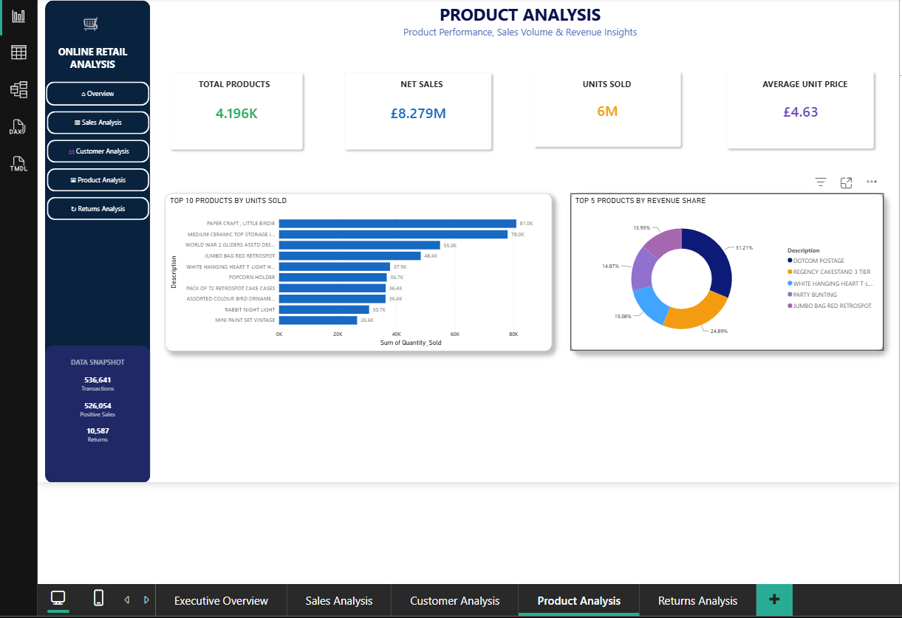
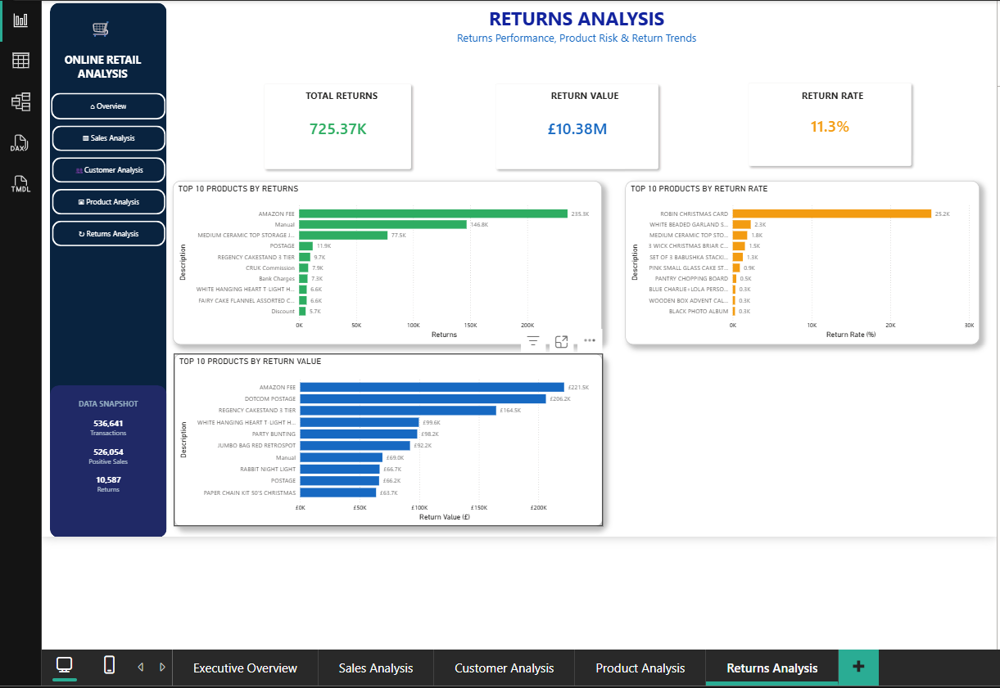

# Online Retail Sales Analysis

An end-to-end retail analytics project using Python, Pandas and Power BI to prepare transaction data, examine sales performance and communicate business patterns through an interactive dashboard.

## Dashboard preview

The Power BI report is organised into five analysis views:

- Executive Overview
- Sales Analysis
- Customer Analysis
- Product Analysis
- Returns Analysis

| Dashboard page | Preview |
|---|---|
| Executive Overview |  |
| Sales Analysis |  |
| Customer Analysis |  |
| Product Analysis |  |
| Returns Analysis |  |

## Business questions

This project explores the following questions:

1. How does sales performance change over time?
2. Which countries contribute the most sales?
3. Which products generate the highest sales?
4. How are sales distributed across customers?
5. How large is the value of returned or cancelled transactions?
6. How do gross sales, returns and net sales compare?

These are descriptive questions. The dashboard can help identify patterns, but the analysis alone does not establish why customers buy or return products.

## Dataset

The analysis is based on the UCI Online Retail dataset.

- **Original size:** 541,909 transaction rows, as reported by the source notebook and UCI dataset page.
- **Period:** 1 December 2010 to 9 December 2011.
- **Currency:** British pounds sterling (GBP).
- **Source:** [UCI Machine Learning Repository — Online Retail](https://archive.ics.uci.edu/dataset/352/online+retail).

The source dataset contains invoice number, stock code, product description, quantity, invoice date, unit price, customer ID and country.

## Analysis workflow

The Jupyter notebook documents the following workflow:

1. Load and inspect the original transaction data.
2. Review missing values, duplicates and data types.
3. Clean and standardise fields needed for analysis.
4. Prepare analytical columns and validate the transformed data.
5. Explore sales, customers, products, countries and returns.
6. Export the prepared dataset for Power BI.
7. Build report pages for business users.

The notebook is available at [Online_Retail_Data_Cleaning_and_Analysis.ipynb](notebooks/Online_Retail_Data_Cleaning_and_Analysis.ipynb).

## Key deliverables

- [Open the Power BI report file](powerbi/Online_Retail_Sales_Analysis.pbix)
- [Open the prepared Excel dataset](data/Online_Retail_Analysis_PowerBI.xlsx)
- [View the analysis notebook](notebooks/Online_Retail_Data_Cleaning_and_Analysis.ipynb)
- [Browse all dashboard screenshots](images/)

The Power BI file and prepared Excel workbook are stored using Git LFS. To clone the repository and retrieve those files, install Git LFS first, clone the repository, then run \`git lfs pull\`.

## Reproducing the notebook

The notebook currently reads the original source file from \`data/Online Retail.xlsx\`. That original file is not included in this repository. To rerun the notebook:

1. Download \`Online Retail.xlsx\` from the [UCI dataset page](https://archive.ics.uci.edu/dataset/352/online+retail).
2. Place it in the repository's \`data\` folder using the exact filename \`Online Retail.xlsx\`.
3. Open the notebook in Jupyter Notebook or Google Colab.
4. If using Colab, update the input path to the location where you uploaded the file.
5. Run the notebook from top to bottom.

The prepared workbook in this repository is an output for the Power BI report; it is not a substitute for the original input file expected by the notebook.

## Tools

| Tool | Role |
|---|---|
| Python | Data preparation and analysis |
| Pandas and NumPy | Data manipulation and numerical operations |
| Jupyter Notebook | Documenting the workflow |
| Microsoft Excel | Prepared dataset |
| Power BI and DAX | Dashboard and measures |
| Git, GitHub and Git LFS | Version control and large-file storage |

## Limitations and interpretation

- The dataset covers a historical period and should not be interpreted as current retail performance.
- Invoice records with cancellation indicators and negative quantities require careful treatment when defining returns and sales.
- Customer IDs are not available for every transaction in the original dataset, which limits customer-level analysis.
- The raw source workbook is not committed; users must download it separately to rerun the notebook.
- The Power BI report is provided as a PBIX file. The screenshots are static previews and do not reproduce slicer interactions.

## Author

**Vaibhav Deshmukh**  
[GitHub profile](https://github.com/vaibhavd8080) · [LinkedIn](https://www.linkedin.com/in/vaibhav-deshmukh-211433290/)